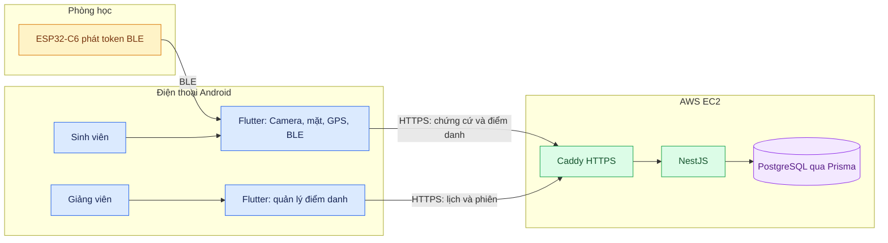

# Hệ thống điểm danh

## 🏗️ KIẾN TRÚC HỆ THỐNG VÀ LUỒNG HOẠT ĐỘNG

**[Bấm để xem bộ 10 sơ đồ kiến trúc bằng tiếng Việt](docs/architecture/README.md)** — gồm luồng sinh viên, giảng viên, khuôn mặt, GPS/BLE, EC2, cơ sở dữ liệu và triển khai.



> Đường mobile-first đã có trong mã và BLE đã được thử với board thật; luồng điểm danh trọn vẹn trên điện thoại thật vẫn cần xác nhận. [Xem trạng thái và bằng chứng](docs/architecture/README.md#phạm-vi-và-bằng-chứng).

Hệ thống gồm API NestJS, ứng dụng Flutter Android, PostgreSQL/Prisma, xác minh
khuôn mặt trên điện thoại, GPS và điểm danh bằng BLE ESP32-C6. Luồng mobile-first
đã có trong mã và được cấu hình cho demo; vẫn cần thử đầu cuối trên điện thoại thật.

## Thành phần

| Thư mục | Nội dung |
| --- | --- |
| `apps/backend/` | API NestJS, Prisma và nghiệp vụ điểm danh. |
| `apps/frontend_student/` | Ứng dụng Flutter cho sinh viên và giảng viên; xử lý khuôn mặt trên Android. |
| `firmware/esp32-c6/` | Firmware board phát token BLE trong phòng học. |
| `services/face_auth/` | Dịch vụ Python/ArcFace của luồng cũ, bật tùy chọn bằng profile `legacy-face`. |
| `infra/` | Docker Compose production, Caddy HTTPS và hướng dẫn triển khai. |

## Yêu cầu

- Docker Engine và Docker Compose để chạy các dịch vụ máy chủ.
- Node.js để chạy backend trực tiếp.
- Flutter SDK để chạy ứng dụng sinh viên.
- PostgreSQL đã có dữ liệu hoặc quyền để migration tạo database mới.

## Cấu hình môi trường

Mẫu biến môi trường nằm trong `infra/.env.example` và
`apps/backend/.env.example`.

### Chạy bằng Docker

```powershell
Copy-Item infra\.env.example infra\.env
```

Mở `infra/.env` và thay các giá trị sau bằng giá trị riêng của môi trường:

- `POSTGRES_PASSWORD`
- `JWT_SECRET`
- `FACE_CLIENT_API_KEY`
- `FACE_ADMIN_API_KEY`

### Chạy backend trực tiếp

```powershell
Copy-Item apps\backend\.env.example apps\backend\.env
```

Mở `apps/backend/.env` và cấu hình các chuỗi kết nối database.

## Chạy toàn bộ hệ thống bằng Docker

```powershell
docker compose --env-file infra/.env -f infra/compose.production.yaml up --build -d
```

Kiểm tra các container:

```powershell
docker compose --env-file infra/.env -f infra/compose.production.yaml ps
```

Kiểm tra API qua tên miền HTTPS đã cấu hình trong `SERVER_NAME`:

```powershell
curl https://<tên-miền>/health
```

Container `migration` tự tạo các database cần thiết và chạy toàn bộ Prisma
migration trước khi backend khởi động.

## Chạy khi phát triển

### Khởi động PostgreSQL cục bộ

```powershell
docker compose -f infra/compose.yaml up -d
```

### Khởi động backend

```powershell
cd apps/backend
npm install
npx prisma migrate deploy
npm run start:dev
```

### Khởi động ứng dụng Flutter

Mở một cửa sổ dòng lệnh khác:

```powershell
cd apps/frontend_student
flutter pub get
flutter run
```

Khi chạy thiết bị thật, đặt địa chỉ API của máy chủ:

```powershell
flutter run --dart-define=API_BASE_URL=https://<máy-chủ>
```

## Xác thực khuôn mặt

Luồng mobile-first dùng MediaPipe Face Landmarker và SFace trên Android. Ảnh
camera không được gửi lên API điểm danh; NestJS kiểm chữ ký và so vector với mẫu
SFace trong `MobileFaceIdentity`. Xem [mô hình khuôn mặt](docs/architecture/04-xu-ly-khuon-mat-tren-dien-thoai.md)
và [quy trình chuẩn bị mẫu](docs/mobile-face-auth-rollout.md).

### Nhánh Face Auth cũ

Face Auth Python đọc embedding ArcFace từ bảng `FaceIdentity` trong PostgreSQL.
Database phải
có dữ liệu khuôn mặt đã enroll trước khi chức năng xác thực được sử dụng.

Để enroll bằng Python:

```powershell
cd services/face_auth
python -m venv .venv
.\.venv\Scripts\python -m pip install -r requirements.txt
$env:FACE_DATABASE_URL = "postgresql://<người-dùng>:<mật-khẩu>@<máy-chủ>:5432/<database>"
.\.venv\Scripts\python enroll_faces.py
```

Ảnh enroll chỉ lưu tại máy thực hiện enroll. Chúng không được đưa lên GitHub.

Container này thuộc profile `legacy-face` và không chạy trong stack mobile-first
mặc định. Khi chủ động bật profile, Dockerfile tải model cần thiết lúc build.

## Điểm danh BLE

Ứng dụng Flutter có hai chế độ quét BLE:

- Chế độ mô phỏng: `--dart-define=USE_MOCK_BLE=true`.
- Chế độ thiết bị thật: `--dart-define=USE_MOCK_BLE=false`.

Với ESP32-C6 hiện tại, app đọc token trong manufacturer data và gửi tới API.
Backend xác thực AES-GCM bằng khóa riêng theo từng board, kiểm phòng đã đăng ký,
cường độ tín hiệu và thời điểm quét. Chế độ mô phỏng không được API production
chấp nhận. Xem [mô hình GPS và BLE](docs/architecture/05-gps-va-ble-esp32-c6.md).

## Tài khoản demo

Chỉ dùng trên database thử nghiệm:

```powershell
cd apps/backend
npm run seed:demo-auth
```

Không chạy lệnh này trên database đang sử dụng thật.

## Triển khai

- Triển khai EC2: `infra/DEPLOY_EC2.md`.
- Thử tải 300 sinh viên: `infra/DEPLOY_300_STUDENTS.md`.

Sử dụng HTTPS trước khi cho người dùng truy cập từ Internet.

## Kiểm thử

```powershell
cd apps/backend
npm run test
```

```powershell
cd services/face_auth
python -m unittest discover -s tests -v
```

## Quy tắc dữ liệu và Git

Không đưa các dữ liệu sau lên GitHub:

- `.env`, mật khẩu, API key và khóa chứng thực.
- Database dump và chuỗi kết nối database thật.
- Ảnh khuôn mặt, embedding và file `face_db`.
- Model tải về, file build, log, `node_modules` và thư mục cache.

Sau khi thay đổi source:

```powershell
git add .
git commit -m "Mô tả thay đổi"
git push
```
