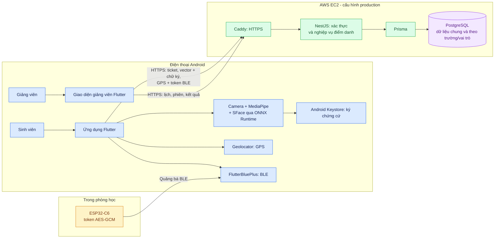

# 01. Kiến trúc tổng thể

[← Mục lục](README.md)

**Ý chính:** ảnh camera được xử lý trên Android ở luồng mobile-first. API nhận vector khuôn mặt và chữ ký để đối chiếu mẫu đã lưu, rồi xét GPS, BLE và phiên điểm danh. Cùng ứng dụng Flutter có màn hình sinh viên và giảng viên; `apps/frontend_teacher/` chỉ chứa các bản thiết kế HTML/ảnh, không phải ứng dụng chạy riêng.

**Tình trạng:** đây là kiến trúc được cấu hình cho demo hiện tại. Đường điểm danh đầy đủ trên điện thoại thật còn chờ kiểm thử. Dịch vụ Python Face Auth là nhánh cũ tùy chọn, xem [mô hình 02](02-kien-truc-cu-va-moi.md).

Đối chiếu: [`student_home_screen.dart`](../../apps/frontend_student/lib/features/student_home/student_home_screen.dart), [`MainActivity.kt`](../../apps/frontend_student/android/app/src/main/kotlin/com/example/frontend_student/MainActivity.kt), [`compose.production.yaml`](../../infra/compose.production.yaml), [`prisma-tenant.service.ts`](../../apps/backend/src/database/prisma/prisma-tenant.service.ts).
