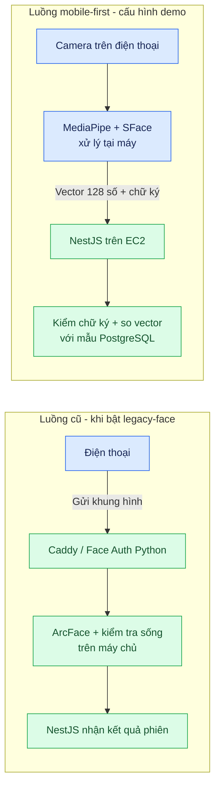

# 02. Kiến trúc cũ và mới

[← Mục lục](README.md)

**Thay đổi:** khâu phát hiện, căn chỉnh và tạo vector khuôn mặt chuyển từ dịch vụ Python trên EC2 sang Android. Máy chủ vẫn **so sánh** vector mới với mẫu SFace và kiểm chữ ký P-256; đây là xác minh cần thiết, không phải chạy mô hình nhận diện ảnh trên EC2. Vì vậy EC2 giảm tải tính toán ảnh, có thể giảm nhu cầu tài nguyên khi nhiều sinh viên cùng điểm danh. Khả năng tải thực tế còn cần đo trên điện thoại và EC2.

**Ranh giới:** `FaceIdentity`/ArcFace và `MobileFaceIdentity`/SFace là hai bộ mẫu riêng, không so chéo. `face-auth` còn trong Compose với profile `legacy-face`; ứng dụng Android thử nghiệm ở `services/face_auth/mobile_android/` chỉ gửi ảnh lên API cũ. Cờ build `MOBILE_FACE_AUTH` chọn đường mới; mã Flutter mặc định bật ở build không phải debug và bản APK demo đã bật cờ này. EC2 đã bật `MOBILE_FACE_AUTH_ENABLED=true` theo [báo cáo rà soát](../ATTENDANCE_REVIEW_2026-10-13.md).

Đối chiếu: [`face_auth_api_service.dart`](../../apps/frontend_student/lib/core/api/face_auth_api_service.dart), [`mobile-face-auth.service.ts`](../../apps/backend/src/modules/students/mobile-face-auth.service.ts), [`compose.production.yaml`](../../infra/compose.production.yaml), [quy trình chuyển đổi](../mobile-face-auth-rollout.md).
