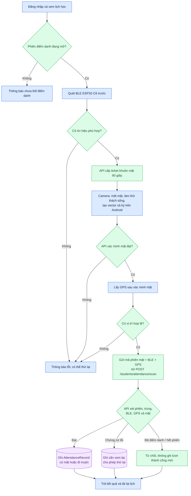

# 03. Luồng điểm danh của sinh viên

[← Mục lục](README.md)

**Thứ tự theo mã Flutter:** quét BLE → màn hình xác minh mặt → lấy GPS → gửi lượt điểm danh. Ticket mặt được xin khi màn hình camera mở. API `/scan` kiểm điều kiện rồi ghi `AttendanceRecord`. Bản ghi đạt là `present` hoặc `late`; chứng cứ lỗi có thể thành `flagged`/`needs_review`; phiên đóng và điểm danh trùng bị từ chối.

**Lưu ý:** đăng nhập, xem lịch và mở phiên dùng các API khác nhau. Hình trên mô tả build bật cả `MOBILE_FACE_AUTH` và `BLE_ATTENDANCE_ENABLED`; chưa có lượt xác nhận đầu cuối trên điện thoại thật.

Đối chiếu: [`student_home_screen.dart`](../../apps/frontend_student/lib/features/student_home/student_home_screen.dart), [`students.controller.ts`](../../apps/backend/src/modules/students/students.controller.ts), [`students.service.ts`](../../apps/backend/src/modules/students/students.service.ts).
