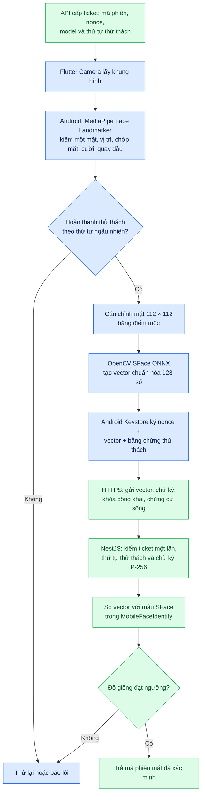
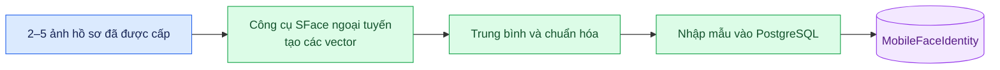

# 04. Xử lý khuôn mặt trên điện thoại

[← Mục lục](README.md)

## Khi điểm danh

**Dữ liệu gửi lên:** vector 128 số đã chuẩn hóa, mã phiên, nonce, khóa công khai, chữ ký số và số đo thử thách sống. **Ảnh camera/khung hình không gửi lên EC2 trong luồng mới.** Chữ ký và nonce chỉ bảo vệ gói chứng cứ; backend vẫn so vector với mẫu SFace. Khóa bí mật ở Android Keystore không rời điện thoại. Lần khớp thành công đầu tiên có thể gắn khóa công khai của máy với sinh viên; các lần sau phải dùng khóa đang hoạt động.

## Chuẩn bị mẫu trước buổi điểm danh

Mẫu SFace được tạo **trước** buổi học từ ảnh hồ sơ bằng công cụ chuẩn bị và nhập vào `MobileFaceIdentity`. Camera khi điểm danh không tự thay mẫu. Mã còn có API đăng ký đáng tin cậy qua xác minh ArcFace cũ; quy trình vận hành mobile-first hiện mô tả cách nhập mẫu ngoại tuyến. Không đưa ảnh hồ sơ vào repository.

**Giới hạn:** kiểm tra sống dựa trên số đo MediaPipe và chứng cứ do ứng dụng gửi; chưa có kiểm thử chống giả mạo đầu cuối trên máy thật. Xem [báo cáo rà soát](../ATTENDANCE_REVIEW_2026-10-13.md).

Đối chiếu: [`MainActivity.kt`](../../apps/frontend_student/android/app/src/main/kotlin/com/example/frontend_student/MainActivity.kt), [`mobile_face_verification_screen.dart`](../../apps/frontend_student/lib/features/face_verification/mobile_face_verification_screen.dart), [`mobile-face-auth.service.ts`](../../apps/backend/src/modules/students/mobile-face-auth.service.ts), [`build_mobile_face_reference.py`](../../services/face_auth/tools/build_mobile_face_reference.py).
