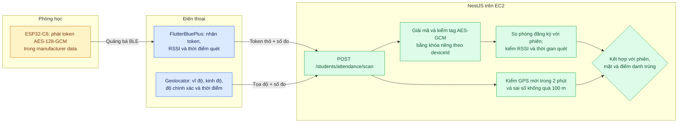

# 05. GPS và BLE ESP32-C6

[← Mục lục](README.md)

**BLE:** app lấy 26 byte quảng bá từ ESP32-C6 và chuyển nguyên token đến API. Server đọc `deviceId`, tìm khóa của board trong registry riêng, xác thực tag AES-GCM, lấy `beaconId`/`roomId` từ cấu hình server và so với phòng của phiên. API còn từ chối mô phỏng, token sai, tín hiệu dưới ngưỡng, thời gian quét ngoài 5–8 giây hoặc thời điểm quét không phù hợp. Token thô không được lưu trong JSON chứng cứ.

**GPS:** API kiểm tọa độ có trong yêu cầu, độ chính xác tối đa 100 m và thời điểm lấy cách hiện tại không quá 2 phút. **Mã hiện tại chưa so tọa độ với ranh giới địa lý của phòng học**; BLE đảm nhận kiểm phòng theo registry. Không nên gọi GPS là xác nhận người đang ở đúng phòng.

**Giới hạn demo:** `BLE_DEMO_ROOM_ID=ROOM_PHONG_LAB_02` ánh xạ mọi lịch demo vào một beacon. Firmware chưa đưa thời gian tuyệt đối vào token nên một quảng bá hợp lệ có thể bị chuyển tiếp; RSSI và thời gian quét do điện thoại báo không chống được ứng dụng bị sửa.

Đối chiếu: [`SecureAttendance_C6.ino`](../../firmware/esp32-c6/SecureAttendance_C6.ino), [`ble_scanner.dart`](../../apps/frontend_student/lib/core/ble/ble_scanner.dart), [`ble-c6-verifier.ts`](../../apps/backend/src/modules/attendance/ble-c6-verifier.ts), [`ble-test.config.ts`](../../apps/backend/src/modules/attendance/ble-test.config.ts), [`students.service.ts`](../../apps/backend/src/modules/students/students.service.ts).
