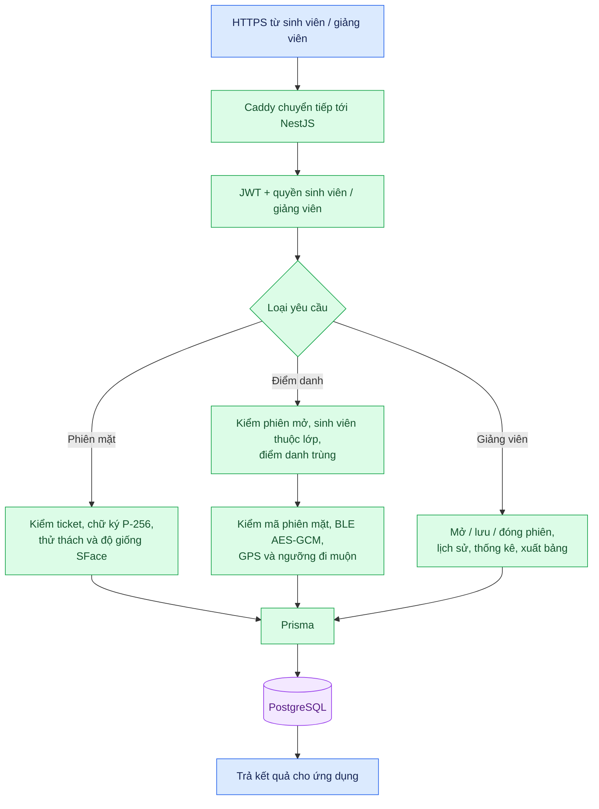

# 06. Hoạt động của máy chủ EC2

[← Mục lục](README.md)

**API hiện tại:** `POST /auth/login` cấp phiên đăng nhập; các route sinh viên/giảng viên dùng JWT và quyền. Xác minh mặt mới dùng `POST /students/attendance/mobile-face-session`, `/complete`; lượt điểm danh cuối dùng `POST /students/attendance/scan`. Prisma chọn database chung cho mẫu mặt và database theo trường/vai trò cho dữ liệu học tập/điểm danh. Cùng một PostgreSQL container có nhiều database trong cấu hình production.

**Kết quả:** API ghi `AttendanceRecord` đạt, đi muộn hoặc cần xem lại; chặn phiên đóng và lượt thành công trùng. Face Auth Python/ArcFace chỉ nằm trong profile Compose `legacy-face`, không chạy khi khởi động lệnh mobile-first không kèm profile. Các route `/face-api` trong Caddy còn để phục vụ nhánh cũ khi được bật.

Đối chiếu: [`auth.controller.ts`](../../apps/backend/src/modules/auth/auth.controller.ts), [`students.service.ts`](../../apps/backend/src/modules/students/students.service.ts), [`lecturers.controller.ts`](../../apps/backend/src/modules/lecturers/lecturers.controller.ts), [`prisma-tenant.service.ts`](../../apps/backend/src/database/prisma/prisma-tenant.service.ts), [`compose.production.yaml`](../../infra/compose.production.yaml).
