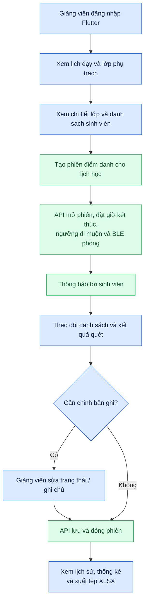

# 07. Luồng giảng viên quản lý điểm danh

[← Mục lục](README.md)

**Trong mã:** giao diện giảng viên nằm trong cùng ứng dụng Flutter. API có xem lớp, tạo phiên, lưu bản ghi, lịch sử, thống kê và xuất XLSX. Khi tạo phiên, backend kiểm lịch/lớp, đặt điều kiện BLE và tạo thông báo. Thao tác `save` vừa lưu các sửa đổi vừa đóng phiên; không có API “đóng riêng” trong controller. Phiên quá giờ cũng có thể được đồng bộ sang trạng thái đóng ở backend.

**Lưu ý:** thư mục `apps/frontend_teacher/` chứa mockup HTML và ảnh giao diện, không phải ứng dụng giảng viên chạy độc lập. Luồng thực tế là `lecturer_home_screen.dart` gọi `LecturersController`.

Đối chiếu: [`lecturer_home_screen.dart`](../../apps/frontend_student/lib/features/lecturer_home/lecturer_home_screen.dart), [`lecturers.controller.ts`](../../apps/backend/src/modules/lecturers/lecturers.controller.ts), [`lecturers.service.ts`](../../apps/backend/src/modules/lecturers/lecturers.service.ts).
