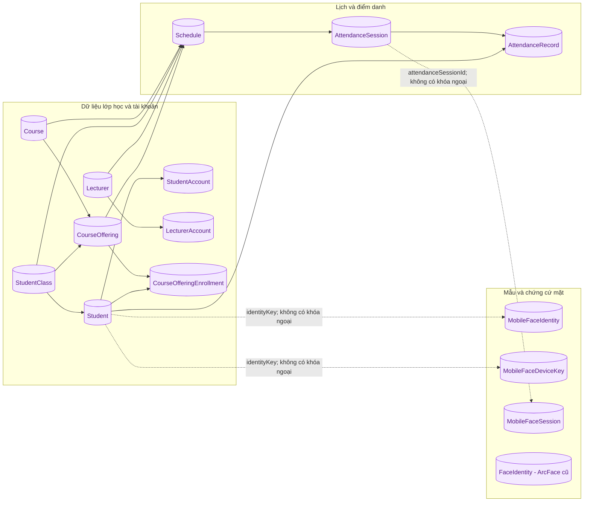

# 08. Cơ sở dữ liệu

[← Mục lục](README.md)

**Quan hệ có khóa ngoại trong Prisma:** lớp → sinh viên; môn/lớp → học phần; học phần + sinh viên → đăng ký; lịch → phiên; phiên + sinh viên → bản ghi. `AttendanceRecord` có ràng buộc duy nhất `(sessionId, studentId)` để không tạo hai bản ghi cho cùng một sinh viên trong một phiên.

**Liên hệ bằng giá trị, không phải khóa ngoại:** ba bảng mobile dùng `identityKey` hoặc `attendanceSessionId` để gắn với sinh viên/phiên. `MobileFaceIdentity` lưu vector mẫu trung bình; `MobileFaceDeviceKey` lưu **khóa công khai**; `MobileFaceSession` lưu thử thách, trạng thái dùng một lần và kết quả kiểm. `FaceIdentity` là mẫu ArcFace của nhánh cũ. Đường chấm trong sơ đồ biểu thị liên hệ logic, không phải ràng buộc Prisma.

**Vị trí dữ liệu:** cấu hình production có một PostgreSQL container nhưng nhiều database: `attendance_db` cho mẫu mặt/trung tâm và các database sinh viên, giảng viên theo trường HUCE/HUST. Cùng một `schema.prisma` được migration vào các database; sơ đồ trên là mô hình bảng, không có nghĩa mọi bảng đều chứa dữ liệu ở mọi database.

Đối chiếu: [`schema.prisma`](../../apps/backend/prisma/schema.prisma), [`prisma-tenant.service.ts`](../../apps/backend/src/database/prisma/prisma-tenant.service.ts), [`compose.production.yaml`](../../infra/compose.production.yaml).
