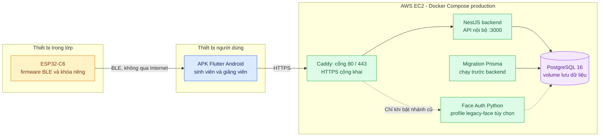

# 09. Triển khai hệ thống

[← Mục lục](README.md)

**Triển khai hiện tại:** APK profile arm64 thử nghiệm có cờ mobile-face và BLE đã build; board thật đã nạp firmware; trên EC2, Caddy, NestJS và PostgreSQL đã chạy khỏe theo báo cáo ngày 13/10. `migration` là tác vụ chuẩn bị database, không phải API lâu dài. Caddy nhận HTTPS, các container ứng dụng và database nằm trên mạng Docker nội bộ.

**Chưa xác nhận:** APK chưa được cài và thử luồng đầy đủ trên điện thoại Android thật. Bản profile được ký bằng Android Debug để thử, chưa phải bản phát hành. `face-auth` là container tùy chọn của nhánh cũ, không thuộc stack mobile-first mặc định.

Đối chiếu: [`compose.production.yaml`](../../infra/compose.production.yaml), [`Caddyfile`](../../infra/caddy/Caddyfile), [runbook EC2](../MOBILE_FIRST_EC2_RUNBOOK.md), [báo cáo rà soát](../ATTENDANCE_REVIEW_2026-10-13.md).
