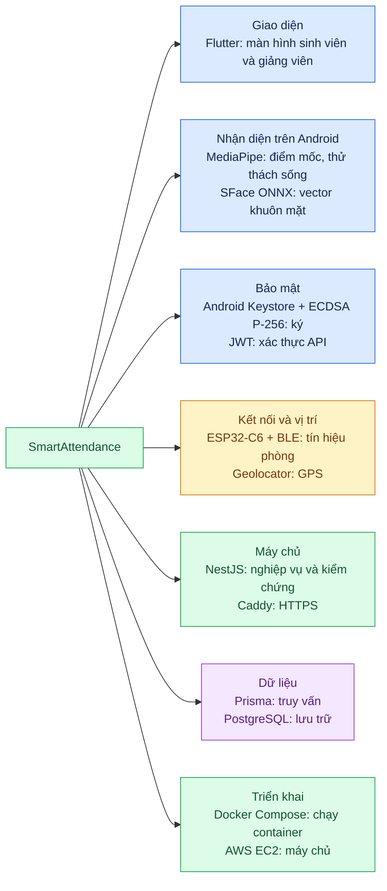

# 10. Công nghệ đang sử dụng

[← Mục lục](README.md)

| Nhóm | Dùng để làm gì? | Vị trí |
| --- | --- | --- |
| Flutter + Camera | Hiện giao diện, thu hình khi xác minh mặt | Điện thoại Android |
| MediaPipe Face Landmarker | Tìm điểm mốc mặt; hỗ trợ kiểm chớp mắt, cười, quay đầu | Điện thoại Android |
| OpenCV SFace + ONNX Runtime | Tạo vector khuôn mặt 128 số để so sánh | Điện thoại; công cụ chuẩn bị mẫu ngoại tuyến |
| Android Keystore + ECDSA P-256 | Giữ khóa bí mật trong thiết bị, ký chứng cứ mặt | Điện thoại; NestJS kiểm chữ ký |
| FlutterBluePlus + ESP32-C6 | Thu token BLE do board trong phòng phát | Điện thoại và board |
| AES-128-GCM | Xác thực token BLE bằng khóa riêng của từng board | Firmware và NestJS |
| Geolocator | Lấy tọa độ, độ chính xác và thời điểm GPS | Điện thoại |
| NestJS + JWT | Xử lý API, đăng nhập, quyền và quyết định điểm danh | EC2 |
| Prisma + PostgreSQL | Đọc/ghi lịch, phiên, bản ghi và mẫu mặt | EC2 |
| Caddy + Docker Compose + AWS EC2 | HTTPS và vận hành các container | EC2 |

**Nhánh cũ:** Python Face Auth dùng ArcFace để xử lý ảnh trên máy chủ nếu chủ động bật profile `legacy-face`. Không trộn nó vào đường xử lý mặt mobile-first.

Đối chiếu: [`pubspec.yaml`](../../apps/frontend_student/pubspec.yaml), [`build.gradle.kts`](../../apps/frontend_student/android/app/build.gradle.kts), [`package.json`](../../apps/backend/package.json), [`compose.production.yaml`](../../infra/compose.production.yaml), [`SecureAttendance_C6.ino`](../../firmware/esp32-c6/SecureAttendance_C6.ino).
