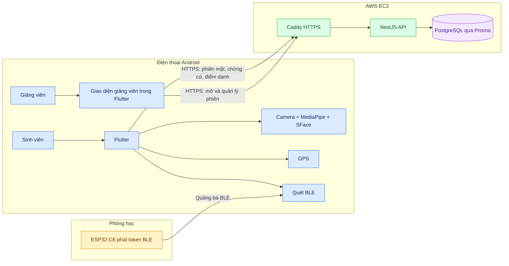

# Kiến trúc hệ thống SmartAttendance

> **Trạng thái ngày 13/10/2026:** mã ứng dụng và API đã nối luồng điểm danh bằng khuôn mặt trên điện thoại, GPS và BLE ESP32-C6. Board thật đã phát token, API trên EC2 đã xác thực token và bản APK thử nghiệm đã build. **Chưa kiểm thử trọn luồng điểm danh trên điện thoại Android thật.**

## Xem nhanh

**Cách đọc:** mũi tên là chiều truyền dữ liệu hoặc yêu cầu. Màu xanh dương là điện thoại, vàng là thiết bị lớp học, xanh lá là máy chủ và tím là dữ liệu. Sơ đồ tổng thể chỉ tóm tắt; mỗi trang bên dưới giải thích một phần và ghi rõ giới hạn.

## Mười mô hình

| Số | Sơ đồ | Câu hỏi được trả lời |
| --- | --- | --- |
| 01 | [Kiến trúc tổng thể](01-kien-truc-tong-the.md) | Thành phần nào chạy ở đâu? |
| 02 | [Kiến trúc cũ và mới](02-kien-truc-cu-va-moi.md) | Việc xử lý mặt đã chuyển như thế nào? |
| 03 | [Luồng điểm danh sinh viên](03-luong-diem-danh-sinh-vien.md) | Sinh viên thao tác theo thứ tự nào? |
| 04 | [Xử lý khuôn mặt](04-xu-ly-khuon-mat-tren-dien-thoai.md) | Ảnh và vector được xử lý ở đâu? |
| 05 | [GPS và BLE ESP32-C6](05-gps-va-ble-esp32-c6.md) | Máy chủ kiểm tra chứng cứ vị trí ra sao? |
| 06 | [Máy chủ EC2](06-hoat-dong-may-chu-ec2.md) | API quyết định và ghi dữ liệu thế nào? |
| 07 | [Luồng giảng viên](07-luong-giang-vien.md) | Giảng viên mở, theo dõi, chốt phiên ra sao? |
| 08 | [Cơ sở dữ liệu](08-co-so-du-lieu.md) | Các bảng chính liên hệ thế nào? |
| 09 | [Triển khai](09-trien-khai-he-thong.md) | Thiết bị và container được đặt ở đâu? |
| 10 | [Công nghệ](10-cong-nghe-su-dung.md) | Mỗi công nghệ phục vụ việc gì? |

## Phạm vi và bằng chứng

- **Đã có trong mã:** ứng dụng Flutter cho cả hai vai trò, API NestJS, Prisma/PostgreSQL, xử lý MediaPipe và SFace trên Android, khóa ký Android Keystore, GPS, BLE C6 và luồng giảng viên.
- **Đã xác nhận từng phần:** build và kiểm thử tự động; board ESP32-C6 thật phát token; backend EC2 xác thực token thật. Xem [báo cáo rà soát](../ATTENDANCE_REVIEW_2026-10-13.md).
- **Chưa xác nhận đầu cuối:** cài APK lên điện thoại thật và đi hết luồng camera → BLE/GPS → điểm danh → lịch sử.
- **Nhánh cũ:** dịch vụ Python Face Auth/ArcFace và ứng dụng Android thử nghiệm trong `services/face_auth/mobile_android/` còn trong mã. Compose production chỉ chạy Face Auth khi bật profile `legacy-face`; đây không phải đường chính của bản mobile-first.
- **Cấu hình demo:** EC2 hiện yêu cầu BLE và dùng chung một beacon `ROOM_PHONG_LAB_02` cho các lịch demo. Cách này chưa đại diện cho triển khai nhiều phòng.

Nguồn đối chiếu chính: [`apps/frontend_student/`](../../apps/frontend_student/), [`apps/backend/`](../../apps/backend/), [`schema.prisma`](../../apps/backend/prisma/schema.prisma), [`firmware/esp32-c6/`](../../firmware/esp32-c6/), [`infra/compose.production.yaml`](../../infra/compose.production.yaml), [quy trình mobile-first](../mobile-face-auth-rollout.md) và [runbook EC2](../MOBILE_FIRST_EC2_RUNBOOK.md).
